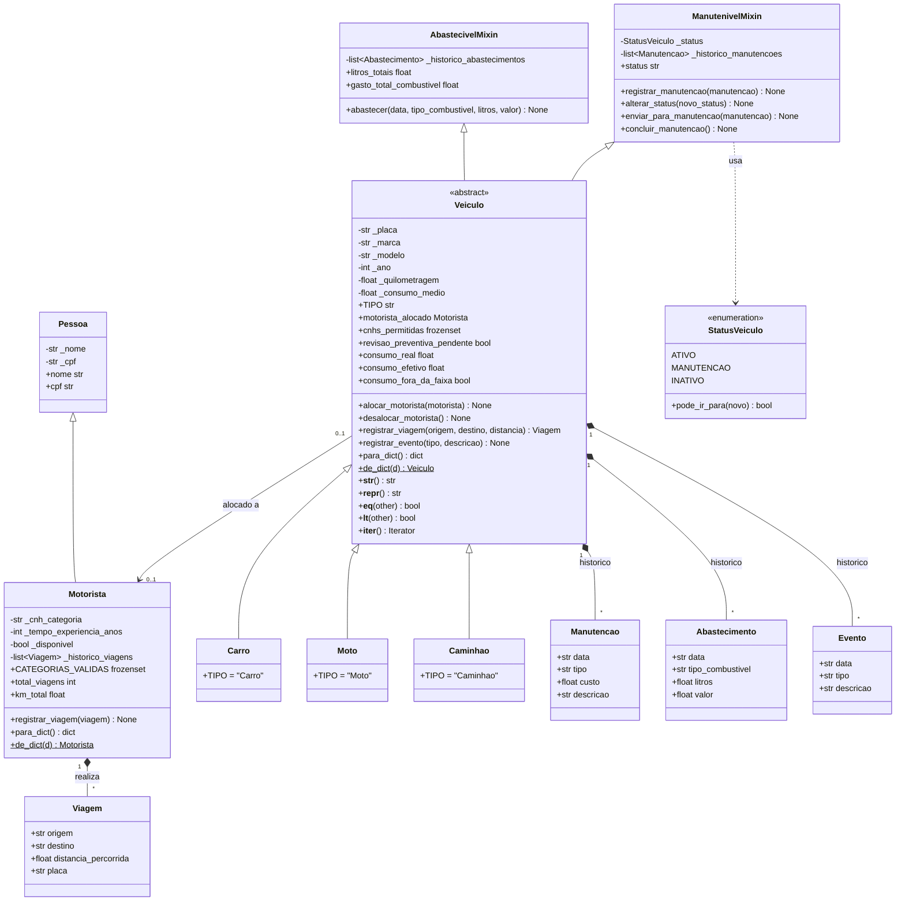

# gerenciamento-de-frota-de-veiculos

## Definição do projeto e Funcionalidades
>Este projeto consiste em um sistema de gerenciamento de frota de veículos desenvolvido em Python como parte da disciplina de Programação Orientada a Objetos.
 
>O projeto objetiva gerenciar a frota de veículos e motoristas de uma empresa de transportes, permitindo o controle de manutenções, o histórico de abastecimentos, a alocação de viagens e a geração de relatórios operacionais e de custos.

## 🧩 Diagrama UML



## Arquitetura do Projeto

>Estrutura de Diretórios

```text
gerenciamento-de-frota-de-veiculos/
│
cli.py
src/
├── config.py, excecoes.py, settings.json
├── modelos/        pessoa, motorista, mixins, veiculo, registros, status, estrategias
├── repositorios/   base (interface), json_repository, sqlite_repository
└── servicos/       frota_service (casos de uso), relatorios
tests/
```

## Decisões de design
- **Herança múltipla:** `Veiculo(AbastecivelMixin, ManutenivelMixin)`. Cada mixin chama `super().__init__`, então o MRO inicializa tudo.
- **Encapsulamento:** atributos privados com `@property` e validações nos setters (km ≥ 0, consumo > 0, CNH válida...).
- **Métodos especiais:** `__str__`, `__repr__`, `__eq__` (placa), `__hash__`, `__lt__` (km) e `__iter__` (manutenções).
- **State/Enum:** `StatusVeiculo` com transições ATIVO↔MANUTENCAO e ATIVO→INATIVO. Veículo com motorista alocado não muda de status.
- **Strategy:** `Basica`, `Complexa` e `Pesada` calculam o custo de manutenção a partir de `custos_manutencao` no `settings.json`.
- **Repository:** `RepositorioBase` define o contrato. O domínio não conhece JSON nem SQLite; ele só expõe `para_dict`/`de_dict`.
- **Regras configuráveis (`settings.json`):** limite de km da revisão, faixa de consumo (global e por tipo), custos de manutenção e CNH mínima por tipo.
- **Revisão preventiva:** o contador de km parte do cadastro. Manutenção `preventiva` zera o contador. Com revisão pendente, a alocação é bloqueada (`PoliticaNaoAtendidaError`).
- **Consumo real:** (km rodados desde o cadastro) ÷ (litros abastecidos). Sem dados, usa o consumo declarado.
- **Exceções:** `ManutencaoInvalidaError`, `AlocacaoInvalidaError`, `PoliticaNaoAtendidaError`, `RepositorioError`, `NaoEncontradoError`.

## Como Executar o Sistema 
Atualmente o sistema encontra-se em fase de modelagem inicial.  
Para verificar a estrutura de módulos:
1. Clone o repositório.
2. Certifique-se de ter o Python 3.10+ instalado.
